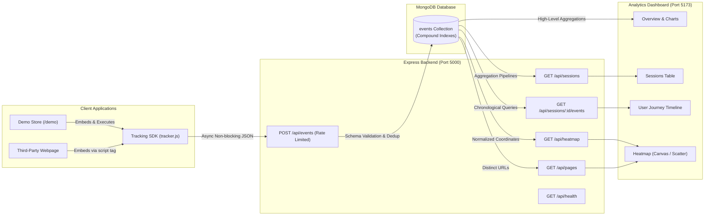

# CausalFunnel User Behavior Analytics Platform

A production-grade, full-stack user behavior tracking and analytics platform inspired by **CausalFunnel**. The system tracks real-time client interactions (`page_view` and `click` events), ingests them through a hardened Express REST API, stores them in MongoDB, derives visitor sessions using high-performance aggregation pipelines, and visualizes journeys and click heatmaps on an interactive React dashboard.

---

## Table of Contents

1. [Project Overview](#1-project-overview)
2. [Key Features](#2-key-features)
3. [Technology Stack](#3-technology-stack)
4. [Architecture Overview](#4-architecture-overview)
5. [Database Schema & Design Decisions](#5-database-schema--design-decisions)
6. [API Endpoint Documentation](#6-api-endpoint-documentation)
7. [Prerequisites](#7-prerequisites)
8. [Installation & Setup](#8-installation--setup)
9. [Environment Variables](#9-environment-variables)
10. [Database Management & Zero-Config Fallback](#10-database-management--zero-config-fallback)
11. [Running the Application](#11-running-the-application)
12. [Testing the Tracking SDK & Embedding Guide](#12-testing-the-tracking-sdk--embedding-guide)
13. [Generating Demo Sessions & Heatmap Data](#13-generating-demo-sessions--heatmap-data)
14. [Automated Testing](#14-automated-testing)
15. [Deployment Guide](#15-deployment-guide)
16. [Assumptions & Engineering Trade-offs](#16-assumptions--engineering-trade-offs)
17. [Known Limitations](#17-known-limitations)
18. [Screenshots & UI Walkthrough](#18-screenshots--ui-walkthrough)
19. [Future Enhancements](#19-future-enhancements)

---

## 1. Project Overview

Modern e-commerce analytics platforms require lightweight, non-blocking client tracking combined with server-side event aggregation that can derive user journeys and click density patterns without complex database duplication.

This platform provides:
- **Client-Side Tracking SDK (`tracker.js`)**: A zero-dependency script embeddable on any webpage that manages 30-minute inactivity sessions, tracks page views (including Single-Page Application route changes), logs click coordinates relative to the viewport, and delivers events with an exponential backoff retry mechanism.
- **Hardened Express API**: High-throughput event ingestion protected by rate-limiting, CORS origin validation, Helmet security headers, payload schema enforcement, and idempotent duplicate handling.
- **MongoDB Event Repository**: A unified, append-only `events` collection with compound indexes supporting millisecond aggregations for session metrics and click coordinates.
- **Modern Analytics Dashboard**: A responsive React & Tailwind CSS dashboard featuring real-time overview metrics, paginated session explorer, chronological user journey timelines, and dual-mode click heatmaps (Coordinate Scatter Plot and Smooth Radial Heatmap Overlay).
- **Interactive Demo E-Commerce Store**: A built-in shopping experience (`/demo`) pre-configured with the SDK and a live tracking HUD for real-time demonstration.

---

## 2. Key Features

### Module A: Client-Side Event Tracking SDK
- **Zero Dependencies**: Lightweight script (~4KB) with no external library requirements.
- **Cryptographic Session Management**: Generates cryptographically secure session identifiers (`crypto.randomUUID` with polyfill fallback) and stores them in `localStorage` and first-party cookies.
- **30-Minute Inactivity Window**: Automatically refreshes session expiration on mouse movement/scrolling; generates a new session identifier if inactivity exceeds 30 minutes.
- **SPA Route Change Tracking**: Intercepts `history.pushState`, `history.replaceState`, `popstate`, and `hashchange` to accurately record client-side transitions without duplicate entries.
- **Viewport-Relative Coordinates**: Captures `click_x` and `click_y` alongside `viewport_width` and `viewport_height` for responsive coordinate normalization.
- **Privacy & Safety First**: Never captures password fields (`input[type="password"]`), credit card inputs, or sensitive form values. Elements can be exempted via `data-cf-ignore`.
- **Reliable Non-Blocking Delivery**: Employs non-blocking `fetch` with `keepalive: true` and an in-memory queue with exponential backoff (up to 3 retries).

### Module B: Backend REST API
- **Strict Input Validation**: Enforces valid ISO 8601 timestamps, absolute URLs, recognized event types, and mandatory coordinates for click events.
- **Idempotency & Deduplication**: Unique database index on `event_id` ensures network retries return `409 Conflict` or idempotent acknowledgments without data corruption.
- **Real-Time Aggregations**: Derives session statistics (duration, unique pages, page views, click counts) dynamically using MongoDB aggregation pipelines.
- **Production Security Middleware**: Rate limiting via `express-rate-limit`, security headers via `helmet`, CORS validation, and centralized error handling.
- **Embedded Zero-Config Fallback**: Automatic failover to `mongodb-memory-server` if local MongoDB or Atlas is offline, guaranteeing immediate functionality on clone.

### Module C & D: Analytics Dashboard & Heatmap
- **Overview Dashboard**: Key performance indicators (Total Sessions, Events, Page Views, Clicks, Unique Pages), interaction trend chart (Recharts Area), event composition donut chart, and top visited pages.
- **Sessions Explorer**: Searchable, paginated table displaying shortened session IDs with one-click copy, duration, event breakdown, and deep-link actions.
- **User Journey Timeline**: Vertical chronological event stream displaying event type badges, relative elapsed time offsets, URL targets, and viewport click metadata.
- **Dual-Mode Click Heatmap**:
  - **Mode A (Coordinate Scatter Plot)**: Renders individual clicks with spatial density detection (overlapping clicks dynamically scale in radius and glow intensity).
  - **Mode B (Smooth Radial Heatmap Overlay)**: Generates radial density gradients across a representative page canvas using offscreen canvas masking and a multi-stop color palette (cyan -> green -> yellow -> red).
  - **Viewport Grouping & Normalization**: Viewport selector prevents skew when visitors view pages on differing screen resolutions.

---

## 3. Technology Stack

| Layer | Technologies |
| :--- | :--- |
| **Frontend** | React 18, Vite 6, React Router v6, Tailwind CSS v3, Recharts v2, Lucide React, Axios |
| **Backend** | Node.js (v18+), Express.js (ES Modules), Mongoose v8, Helmet, CORS, Express-Rate-Limit |
| **Database** | MongoDB (local, Docker, or Atlas) with embedded `mongodb-memory-server` fallback |
| **Testing** | Vitest, Supertest |
| **DevOps** | Docker Compose, Concurrently |

---

## 4. Architecture Overview



---

## 5. Database Schema & Design Decisions

### Single Event Collection Pattern

The platform utilizes a single, append-only **`events`** collection. Session metrics are computed on-the-fly using MongoDB aggregation pipelines rather than maintained in a separate synchronized `sessions` document.

#### Why this architecture?
1. **Event Sourcing & Auditability**: Raw user actions are immutable. Storing atomic events avoids race conditions when multiple events arrive simultaneously in high-traffic sessions.
2. **Simplified Ingestion Throughput**: Event tracking endpoints only require a single fast `insert` without executing distributed locks or read-modify-write transactions on parent session records.
3. **Flexible Querying**: Aggregation pipelines can group events by arbitrary dimensions (e.g., sessions, viewports, hours, landing pages) without schema alterations.

### Schema Definition

```javascript
{
  event_id: { type: String, required: true, unique: true, index: true },
  session_id: { type: String, required: true, index: true },
  event_type: { type: String, required: true, enum: ['page_view', 'click'] },
  page_url: { type: String, required: true },
  timestamp: { type: Date, required: true, default: Date.now },
  click_x: { type: Number, required: function() { return this.event_type === 'click'; } },
  click_y: { type: Number, required: function() { return this.event_type === 'click'; } },
  viewport_width: { type: Number },
  viewport_height: { type: Number },
  page_title: { type: String, default: '' },
  referrer: { type: String, default: '' },
  element_tag: { type: String, default: '' },
  element_id: { type: String, default: null },
  createdAt: { type: Date },
  updatedAt: { type: Date }
}
```

### Database Indexes

| Index Keys | Purpose |
| :--- | :--- |
| `{ event_id: 1 }` (Unique) | Prevents duplicate event ingestion across retries; constant-time lookups. |
| `{ session_id: 1, timestamp: 1 }` | Powers chronological timeline retrieval and session aggregation pipelines. |
| `{ page_url: 1, event_type: 1 }` | Optimizes click coordinate filtering for heatmap generation on specific pages. |
| `{ timestamp: -1 }` | Fast sorting for recent events and activity trend calculations. |

---

## 6. API Endpoint Documentation

Base URL: `http://localhost:5000/api`

### 1. Ingest Tracking Event
- **Endpoint**: `POST /api/events`
- **Rate Limit**: 1,000 requests per 15 minutes per IP
- **Description**: Validates and stores incoming `page_view` and `click` events.

#### Example Request (Page View):
```bash
curl -X POST http://localhost:5000/api/events \
  -H "Content-Type: application/json" \
  -d '{
    "event_id": "evt_pv_001",
    "session_id": "sess_8f29d271-9cb1",
    "event_type": "page_view",
    "page_url": "http://localhost:5173/demo",
    "timestamp": "2026-10-14T14:00:00.000Z",
    "page_title": "ShopFlow Store - Home",
    "referrer": "https://google.com"
  }'
```

#### Example Request (Click):
```bash
curl -X POST http://localhost:5000/api/events \
  -H "Content-Type: application/json" \
  -d '{
    "event_id": "evt_ck_002",
    "session_id": "sess_8f29d271-9cb1",
    "event_type": "click",
    "page_url": "http://localhost:5173/demo",
    "timestamp": "2026-10-14T14:00:05.000Z",
    "click_x": 340,
    "click_y": 420,
    "viewport_width": 1440,
    "viewport_height": 900,
    "element_tag": "BUTTON",
    "element_id": "btn-hero-shop-now"
  }'
```

#### Response (201 Created):
```json
{
  "success": true,
  "message": "Event recorded successfully",
  "data": {
    "event_id": "evt_ck_002",
    "session_id": "sess_8f29d271-9cb1",
    "event_type": "click",
    "page_url": "http://localhost:5173/demo",
    "timestamp": "2026-10-14T14:00:05.000Z"
  }
}
```

#### Response (409 Conflict - Duplicate Event ID):
```json
{
  "success": false,
  "message": "Duplicate event_id 'evt_ck_002'. Event has already been processed.",
  "error": "DUPLICATE_EVENT_ID"
}
```

---

### 2. Fetch Sessions List
- **Endpoint**: `GET /api/sessions?page=1&limit=10&search=`
- **Description**: Aggregates event records into visitor sessions, sorted by most recent activity.

#### Response (200 OK):
```json
{
  "success": true,
  "data": [
    {
      "session_id": "sess_8f29d271-9cb1",
      "first_event_at": "2026-10-14T14:00:00.000Z",
      "last_event_at": "2026-10-14T14:12:45.000Z",
      "total_events": 8,
      "page_views": 3,
      "total_clicks": 5,
      "unique_pages": 2,
      "duration_seconds": 765
    }
  ],
  "pagination": {
    "total": 1,
    "page": 1,
    "limit": 10,
    "totalPages": 1
  }
}
```

---

### 3. Fetch Session Event History
- **Endpoint**: `GET /api/sessions/:sessionId/events?page=1&limit=100`
- **Description**: Returns all chronological interactions for a selected session.

#### Response (200 OK):
```json
{
  "success": true,
  "data": [
    {
      "_id": "670d249f31b8c10e08f219a1",
      "event_id": "evt_pv_001",
      "session_id": "sess_8f29d271-9cb1",
      "event_type": "page_view",
      "page_url": "http://localhost:5173/demo",
      "timestamp": "2026-10-14T14:00:00.000Z",
      "page_title": "ShopFlow Store - Home"
    },
    {
      "_id": "670d249f31b8c10e08f219a2",
      "event_id": "evt_ck_002",
      "session_id": "sess_8f29d271-9cb1",
      "event_type": "click",
      "page_url": "http://localhost:5173/demo",
      "timestamp": "2026-10-14T14:00:05.000Z",
      "click_x": 340,
      "click_y": 420,
      "viewport_width": 1440,
      "viewport_height": 900,
      "element_tag": "BUTTON",
      "element_id": "btn-hero-shop-now"
    }
  ],
  "summary": {
    "session_id": "sess_8f29d271-9cb1",
    "first_event_at": "2026-10-14T14:00:00.000Z",
    "last_event_at": "2026-10-14T14:12:45.000Z",
    "total_events": 2,
    "page_views": 1,
    "total_clicks": 1,
    "unique_pages": 1,
    "duration_seconds": 5
  },
  "pagination": {
    "total": 2,
    "page": 1,
    "limit": 100,
    "totalPages": 1
  }
}
```

---

### 4. Fetch Heatmap Data
- **Endpoint**: `GET /api/heatmap?url=<encoded-url>&limit=2000`
- **Description**: Returns all click coordinates recorded for the specified page URL.

#### Response (200 OK):
```json
{
  "success": true,
  "data": {
    "page_url": "http://localhost:5173/demo",
    "total_clicks": 42,
    "returned_clicks": 42,
    "viewports": [
      { "width": 1440, "height": 900, "count": 28 },
      { "width": 1920, "height": 1080, "count": 14 }
    ],
    "clicks": [
      {
        "click_x": 340,
        "click_y": 420,
        "viewport_width": 1440,
        "viewport_height": 900,
        "timestamp": "2026-10-14T14:00:05.000Z",
        "element_tag": "BUTTON",
        "element_id": "btn-hero-shop-now"
      }
    ]
  }
}
```

---

### 5. Fetch Distinct Pages
- **Endpoint**: `GET /api/pages`
- **Description**: Returns distinct tracked URLs with interaction metrics.

---

### 6. Overview Metrics
- **Endpoint**: `GET /api/stats/overview`
- **Description**: High-level platform metrics, interaction trends over time, and top landing pages.

---

### 7. Health Check
- **Endpoint**: `GET /api/health`
- **Description**: Returns backend uptime, service status, and database connectivity.

---

## 7. Prerequisites

- **Node.js**: `v18.0.0` or later (`v22.15+` recommended)
- **npm**: `v9.0.0` or later
- **MongoDB** *(Optional)*: Local MongoDB instance or MongoDB Atlas. If none is available, the built-in zero-config memory server takes over automatically.

---

## 8. Installation & Setup

Clone the repository and install all root, backend, and frontend dependencies in one command:

```bash
git clone <repository-url>
cd causalfunnel-analytics

# Install all dependencies across monorepo
npm run install:all
```

Alternatively, install each workspace individually:

```bash
# Server dependencies
cd server
npm install

# Client dependencies
cd ../client
npm install
cd ..
```

---

## 9. Environment Variables

### Backend Configuration (`server/.env`)

Copy `server/.env.example` to `server/.env`:

```env
PORT=5000
NODE_ENV=development
MONGODB_URI=mongodb://127.0.0.1:27017/causalfunnel_analytics
CLIENT_URL=http://localhost:5173
USE_MEMORY_DB=true
```

- `PORT`: Port on which the Express server listens (default: `5000`).
- `MONGODB_URI`: Connection string for MongoDB (local or Atlas URI).
- `CLIENT_URL`: Allowed frontend origin for CORS.
- `USE_MEMORY_DB`: When set to `true`, automatically starts an embedded in-memory MongoDB instance if the primary MongoDB URI fails to connect.

### Frontend Configuration (`client/.env`)

Copy `client/.env.example` to `client/.env`:

```env
VITE_API_BASE_URL=http://localhost:5000/api
```

---

## 10. Database Management & Zero-Config Fallback

The project features a **resilient database connection layer** designed specifically for hassle-free hiring reviews and local testing:

1. **Local MongoDB**: If you have a local MongoDB daemon running on port 27017, the server connects immediately.
2. **MongoDB via Docker**: To run MongoDB in Docker, execute:
   ```bash
   docker compose up -d
   ```
3. **Automatic Zero-Config In-Memory Fallback**: If no MongoDB daemon is running and no Atlas URI is provided, the backend seamlessly launches an embedded `mongodb-memory-server`. No database installation or cloud account is required to test or run the application.

---

## 11. Running the Application

### Option A: Run Full Stack Concurrently (Recommended)

From the project root:

```bash
npm run dev
```

This starts:
- **Backend API**: `http://localhost:5000`
- **Frontend Dashboard & Demo**: `http://localhost:5173`
- **Tracking SDK Endpoint**: `http://localhost:5000/tracker.js`

### Option B: Run Services Separately

**Terminal 1 (Backend):**
```bash
cd server
npm run dev
```

**Terminal 2 (Frontend):**
```bash
cd client
npm run dev
```

---

## 12. Testing the Tracking SDK & Embedding Guide

### How to Embed the SDK on Any Webpage

Add the script tag to any HTML document's `<head>` or before `</body>`:

```html
<script
  src="http://localhost:5000/tracker.js"
  data-api-url="http://localhost:5000/api/events">
</script>
```

### SDK Verification Checklist:
1. Open your browser's Developer Tools (`F12`) and navigate to the **Network** tab.
2. Load any page containing the script tag. You will observe an immediate non-blocking `POST /api/events` with `event_type: "page_view"`.
3. Click anywhere on the webpage. You will observe a `POST /api/events` with `event_type: "click"`, containing viewport coordinates `(click_x, click_y)`.
4. Inspect `localStorage.getItem('cf_analytics_session')` or the `cf_session_id` cookie in the Application tab to verify session persistence.

### Standalone SDK Test Page:
Open `http://localhost:5000/demo.html` in your browser. This standalone static page served directly by Express demonstrates the tracker in isolation.

---

## 13. Generating Demo Sessions & Heatmap Data

To test the analytics dashboard with realistic data, run the built-in database seeder:

```bash
npm run seed
```

This populates MongoDB with:
- **15 distinct visitor sessions**
- **Dozens of page views and viewport clicks** spread across 5 e-commerce pages
- **Real coordinate clusters** centered around buttons and cards
- **Multiple viewport resolutions** (`1440x900`, `1920x1080`, `1280x800`)

---

## 14. Automated Testing

The backend includes a comprehensive test suite covering all functional acceptance criteria.

Run tests:

```bash
npm test
```

### Test Coverage Highlights:
- [x] Ingestion of valid `page_view` events.
- [x] Ingestion of valid `click` events with coordinate validation.
- [x] Rejection of unsupported event types (`400 Bad Request`).
- [x] Rejection of missing click coordinates for click events.
- [x] Rejection of invalid URLs and timestamps.
- [x] Deduplication logic returning `409 Conflict` on duplicate `event_id`.
- [x] Session aggregation pipeline metrics (`total_events`, `page_views`, `total_clicks`, `unique_pages`, `duration`).
- [x] Chronological event ordering with tie-breaker sorting.
- [x] Heatmap query filtering by URL and `event_type = 'click'`.
- [x] Distinct pages discovery and health checks.

---

## 15. Deployment Guide

### Recommended Cloud Architecture
- **Frontend**: Vercel or Netlify
- **Backend**: Render, Railway, or AWS App Runner
- **Database**: MongoDB Atlas

### Step-by-Step Deployment:

1. **Deploy Database (MongoDB Atlas)**:
   - Create a free cluster on MongoDB Atlas.
   - Whitelist `0.0.0.0/0` (or your backend provider's IP range).
   - Copy the MongoDB connection string.

2. **Deploy Backend (e.g. Render / Railway)**:
   - Connect your GitHub repository and set the root directory to `server`.
   - Set Build Command: `npm install`
   - Set Start Command: `node server.js`
   - Add Environment Variables:
     - `PORT`: `5000` (or provider's default `$PORT`)
     - `NODE_ENV`: `production`
     - `MONGODB_URI`: `<your-mongodb-atlas-uri>`
     - `CLIENT_URL`: `https://your-frontend-app.vercel.app`
     - `USE_MEMORY_DB`: `false`
   - Verify health check at `https://your-backend.onrender.com/api/health`.

3. **Deploy Frontend (e.g. Vercel)**:
   - Connect the repository and configure Root Directory as `client`.
   - Set Build Command: `npm run build`
   - Set Output Directory: `dist`
   - Add Environment Variable:
     - `VITE_API_BASE_URL`: `https://your-backend.onrender.com/api`

4. **Update Tracking Script Tag**:
   - Update `data-api-url` in embedded script tags to point to the production backend:
     ```html
     <script
       src="https://your-backend.onrender.com/tracker.js"
       data-api-url="https://your-backend.onrender.com/api/events">
     </script>
     ```

---

## 16. Assumptions & Engineering Trade-offs

1. **Single Collection vs Separate Session Collection**:
   - *Trade-off*: We chose an event-sourced single `events` collection. Session metrics are derived via aggregation pipelines.
   - *Rationale*: Guarantees write performance at high concurrency without locking parent session rows. For extreme scale (>100M events/day), a Redis cache or materialization worker could periodically snapshot active session aggregates.
2. **Viewport Coordinate Normalization**:
   - *Trade-off*: When rendering heatmaps combining clicks from multiple screen resolutions (e.g., mobile vs desktop), raw coordinates cannot simply be plotted onto a single canvas.
   - *Solution*: The dashboard normalizes coordinates proportionally to a standard reference canvas (`1000x650`) while offering a **Viewport Filter** dropdown to inspect clicks strictly within a specific resolution.
3. **Inactivity Session Expiry**:
   - *Design*: Set to 30 minutes in accordance with Google Analytics and e-commerce standards. The tracker resets this timer on user interaction (`mousemove`, `scroll`, `click`).

---

## 17. Known Limitations

- **Canvas Representation vs Live DOM Screenshot**: The heatmap renders over a representative page wireframe. Capturing full-fidelity visual screenshots of third-party pages with authenticated state requires headless browser infrastructure (e.g., Puppeteer) which is beyond the scope of a client-side tracking script.
- **Dynamic Element Shifts**: If a website layout drastically changes responsively or dynamically shifts elements, click coordinates will accurately reflect where the user clicked relative to the viewport, but may not align with elements that changed positions.

---

## 18. Screenshots & UI Walkthrough

### 1. Analytics Overview Dashboard
- High-level KPI stat cards with trend badges.
- Interaction Timeline area chart showing page view and click volume over time.
- Event composition donut chart.
- Top visited pages and recent session quick-links.

### 2. Visitor Sessions Explorer
- Filterable and paginated table with shortened session IDs, copy-to-clipboard, duration calculation, and activity timestamps.

### 3. User Journey Timeline
- Vertical event stream distinguishing `page_view` from `click` interactions.
- Relative elapsed time indicators (`+0s`, `+5s`, `+12s`).
- Detailed element metadata: `<BUTTON>`, `#btn-hero-shop-now`, viewport coordinates, and URL targets.

### 4. Click Heatmap Visualization
- **Mode A (Coordinate Plot)**: Visual scatter dots with dynamic size and color intensity scaling on click overlap.
- **Mode B (Heatmap Overlay)**: Smooth radial blur heatmap showing click concentration hot spots.
- Interactive tooltip showing coordinates and element targets on hover.

### 5. Interactive Demo E-Commerce Store
- Live shopping application with product catalog, cart management, and floating tracking HUD displaying active session state in real time.

---

## 19. Future Enhancements

- **Scroll Depth Tracking**: Automatically record 25%, 50%, 75%, and 100% vertical scroll milestones.
- **Conversion Funnel Visualization**: Define multi-step funnel paths (e.g. `/demo` → `/demo/products` → `/demo/cart` → Checkout) with drop-off percentage calculations.
- **Session Replay**: Integrate DOM mutation recording (e.g. `rrweb`) for full video-like session playback.
- **Role-Based Access Control (RBAC)**: JWT authentication for dashboard administrators.

---

## License

MIT © 2026 CausalFunnel Analytics Platform
